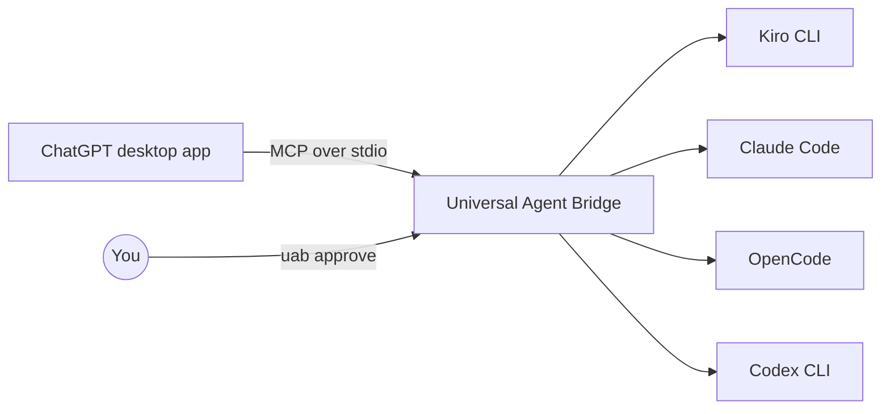

# Universal Agent Bridge (UAB)

> **Status: early development (Phase 3 of 12).** UAB cannot connect to ChatGPT or run tasks
> with any coding agent yet. What works today is the local groundwork: a database, project
> registration, session management and detection of installed coding CLIs, through the `uab`
> command. Do not install it expecting a working bridge.

UAB is a local MCP server for the **ChatGPT desktop app**. The goal is to let ChatGPT plan and
review work while locally installed coding CLIs (Kiro CLI, Claude Code, OpenCode, Codex CLI)
do the implementation, with a human approving every task before it reaches an agent.

## What exists today

- Research and gap analysis: [docs/research-and-gap-analysis.md](docs/research-and-gap-analysis.md)
- Architecture and phase plan: [docs/architecture.md](docs/architecture.md)
- Developer guide: [docs/development.md](docs/development.md)
- A local SQLite database with versioned, checksummed migrations and automatic backups
- Project registration with path validation (absolute paths only, symlinks resolved, home
  directory and filesystem roots refused)
- Sessions bound to one project and one agent, protected by a per-session token
- Detection of Kiro CLI, Claude Code, OpenCode and Codex CLI: installed or not, version, and
  login status from each CLI's own status command (UAB never asks for credentials). See
  [docs/supported-agents.md](docs/supported-agents.md)
- A `uab` command for all of the above

## Trying the current build

Requirements: Node.js 22.13 or later, npm.

```bash
git clone <repository-url>
cd universal-agent-bridge
npm install
npm run build

# Register a project directory (use your own absolute path)
node dist/cli.js project add /absolute/path/to/your-project --name "My Project"

# Create a session for it (agents: kiro, claude, opencode, codex)
node dist/cli.js session create --project /absolute/path/to/your-project --agent kiro

node dist/cli.js session list

# See which coding CLIs are installed and logged in
node dist/cli.js agents status
node dist/cli.js --help
```

On Windows use a path such as `C:\Projects\MyProject`.

`session create` prints a session id and a token **once**. UAB stores only a hash of the token.
In later phases you will give both to the one ChatGPT conversation that should use the session.
`uab session rotate-token <id>` issues a new token and revokes the old one.

UAB keeps its data in `%LOCALAPPDATA%\uab` (Windows), `~/Library/Application Support/uab`
(macOS) or `~/.local/share/uab` (Linux). Set `UAB_HOME` to an absolute path to use another
directory. `uab config` shows the resolved locations.

## Planned design (not implemented)



- Each ChatGPT conversation uses its own UAB session, identified by a session id and token,
  because the desktop app does not tell MCP servers which conversation is calling.
- ChatGPT proposes a task; you approve the exact prompt (bound to its hash) outside the chat;
  only then can the task be dispatched.
- Each coding CLI keeps its own login and its own permission rules.

See [docs/architecture.md](docs/architecture.md) for details and known limitations.

## Development

```bash
npm run check      # typecheck, lint, format check, tests, build
```

| Script                                                     | Purpose                      |
| ---------------------------------------------------------- | ---------------------------- |
| `npm run build`                                            | Compile `src/` to `dist/`    |
| `npm run typecheck`                                        | Type-check sources and tests |
| `npm run lint` / `lint:fix`                                | ESLint                       |
| `npm run format` / `format:check`                          | Prettier                     |
| `npm test`                                                 | All tests                    |
| `npm run test:unit` / `test:integration` / `test:security` | Test subsets                 |

More in [docs/development.md](docs/development.md).

## Licence

[MIT](LICENSE)
