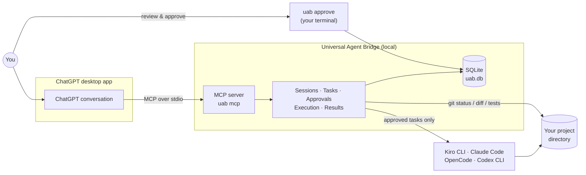

# Universal Agent Bridge (UAB)

UAB connects the **ChatGPT desktop app** to the coding CLIs installed on your computer
(**Kiro CLI, Claude Code, OpenCode and Codex CLI**). ChatGPT plans and reviews; a coding agent
does the implementation in your project; **you approve every task before it reaches an agent.**
Results (agent summary, changed files, git diff, test results) flow back to the same ChatGPT
conversation, so you stop copy-pasting prompts and terminal output between windows.

> **Status: 0.1.0, early release.** The full workflow works end to end with **Kiro CLI**
> (verified on Windows 11). The Claude Code, OpenCode and Codex CLI integrations are built and
> tested against recorded or documented output, but have **not** completed a real end-to-end
> run yet. See [Status of each agent](#status-of-each-agent) and [Roadmap](#roadmap).

- [Why UAB] (#why-uab)
- [Features](#features)
- [How it works](#how-it-works)
- [Prerequisites](#prerequisites)
- [Installation](#installation)
- [Connect ChatGPT Desktop](#connect-chatgpt-desktop)
- [Connect your coding agents](#connect-your-coding-agents)
- [First-time walkthrough](#first-time-walkthrough)
- [Sessions](#sessions)
- [Approvals and security](#approvals-and-security)
- [Command reference](#command-reference)
- [Configuration](#configuration)
- [Troubleshooting](#troubleshooting)
- [Development](#development)
- [Roadmap](#roadmap)
- [Contributing](#contributing) · [Licence](#licence)

## Why UAB

A typical loop with ChatGPT and a coding agent looks like this: ask ChatGPT for a plan, copy its
prompt into the agent's terminal, wait, copy the agent's output back, ask ChatGPT to review,
copy the corrections back, and repeat. UAB removes the copying while keeping you in charge:

- ChatGPT **proposes** a task through UAB.
- You **review the exact prompt** in a terminal and approve or reject it.
- UAB runs the agent in your registered project directory and collects the results.
- ChatGPT reads the results, reviews them and proposes the next task, which again needs your
  approval.

UAB is for developers who already use ChatGPT for planning and one or more coding CLIs for
implementation, and want them to work together without giving either one unchecked access.

## Features

- **ChatGPT Desktop integration** through a local MCP server (stdio). No custom web app and
  no public endpoint.
- **Four coding agents** behind one adapter interface: Kiro CLI, Claude Code, OpenCode, Codex
  CLI. Adding another agent means adding one definition file.
- **Per-conversation sessions.** Each ChatGPT conversation gets its own session id and token,
  bound to one project directory and agent. Other conversations cannot see its tasks or results.
- **Human approval for every task**, bound to the session, agent, project, prompt version and
  SHA-256 of the exact prompt. Single use, expiring, never automatic.
- **Agent-native permissions stay on.** UAB never passes flags such as
  `--dangerously-skip-permissions`, `--trust-all-tools`, `--auto` or `danger-full-access`.
- **Two-way results:** final message, status, permission denials, changed files, git status
  and diff, commits created, duration, redacted logs, and an independent test run.
- **Native login reuse.** UAB never asks for or stores passwords or API keys.
- **Security controls:** project directory confinement with symlink checks, no shell, secret
  redaction, output limits, one writer per working tree, audit log.

## How it works



1. The ChatGPT desktop app starts `uab mcp` as a local process and talks to it over stdio
   using the Model Context Protocol (MCP). UAB exposes about 30 tools (sessions, tasks,
   approvals, results, read-only project inspection). There is **no** shell or file-write tool.
2. ChatGPT calls `propose_task`. UAB stores the prompt, adds a short fixed rules header, and
   computes its SHA-256. The task waits in the approval queue.
3. You run `uab approve <task-id>` in a terminal. UAB shows the complete prompt and its hash.
   Because approval happens outside the chat, ChatGPT cannot approve on its own.
4. ChatGPT calls `dispatch_task`. UAB checks the approval, consumes it, and starts the agent's
   CLI (for example `kiro-cli chat --no-interactive`) in the project directory with the
   prompt on stdin. The agent's own permission rules decide what it may do.
5. UAB records the output, collects git changes, optionally runs your test command, and
   ChatGPT reads it all with `get_task_result`.

Architecture details: [docs/architecture.md](docs/architecture.md). Research and design
reasoning: [docs/research-and-gap-analysis.md](docs/research-and-gap-analysis.md).

## Prerequisites

| Requirement             | Details                                                                                                                                                                                                                                                                                                                                              |
| ----------------------- | ---------------------------------------------------------------------------------------------------------------------------------------------------------------------------------------------------------------------------------------------------------------------------------------------------------------------------------------------------- |
| Operating system        | Windows 10/11, macOS or Linux. Developed and verified on **Windows 11**; CI runs the test suite on Windows, macOS and Linux.                                                                                                                                                                                                                         |
| Node.js                 | **22.13 or later** (uses the built-in `node:sqlite`). Check with `node --version`.                                                                                                                                                                                                                                                                   |
| Git                     | Needed for changed-file and diff reporting.                                                                                                                                                                                                                                                                                                          |
| ChatGPT desktop app     | The current desktop app for macOS, Windows or Linux, signed in, with access to threads that run locally. Local MCP servers are configured through the MCP configuration it shares with Codex (`~/.codex/config.toml`). Your plan and workspace policy must allow local MCP servers. ChatGPT **web** cannot start local servers and is not supported. |
| At least one coding CLI | Kiro CLI, Claude Code, OpenCode or Codex CLI, installed and logged in with its own login command.                                                                                                                                                                                                                                                    |

## Installation

```bash
git clone <repository-url>
cd universal-agent-bridge
npm install
npm run build
```

Make the `uab` command available everywhere (optional but assumed below):

```bash
npm link
uab --version
```

Without `npm link`, replace `uab` with `node /absolute/path/to/universal-agent-bridge/dist/cli.js`.

Check the installation:

```bash
uab config          # where UAB keeps its data and which settings are active
uab agents status   # which coding CLIs are installed and logged in
```

UAB stores its database in `%LOCALAPPDATA%\uab` (Windows), `~/Library/Application Support/uab`
(macOS) or `~/.local/share/uab` (Linux). Set `UAB_HOME` to an absolute path to use another
directory.

## Connect ChatGPT Desktop

### 1. Generate the configuration

```bash
uab mcp-config
```

This prints a block with the real paths of your Node.js and UAB installation, for example on
Windows:

```toml
[mcp_servers.uab]
command = "C:\\Program Files\\nodejs\\node.exe"
args = ["C:\\Projects\\universal-agent-bridge\\dist\\cli.js", "mcp"]
startup_timeout_sec = 30
tool_timeout_sec = 120
# Ask before every tool that is not read-only.
default_tools_approval_mode = "writes"

[mcp_servers.uab.tools.dispatch_task]
approval_mode = "prompt"

[mcp_servers.uab.tools.approve_task]
approval_mode = "prompt"

[mcp_servers.uab.tools.cancel_task]
approval_mode = "prompt"
```

Always use the output of `uab mcp-config` rather than copying this example. If you set
`UAB_HOME`, run `uab mcp-config --uab-home <same absolute path>` so the app uses the same data.

### 2. Add it to the MCP configuration

The ChatGPT desktop app, Codex CLI and the Codex IDE extension share one MCP configuration file:

| OS            | File                                                                               |
| ------------- | ---------------------------------------------------------------------------------- |
| Windows       | `%USERPROFILE%\.codex\config.toml` (for example `C:\Users\you\.codex\config.toml`) |
| macOS / Linux | `~/.codex/config.toml`                                                             |

If `CODEX_HOME` is set, the file is `$CODEX_HOME/config.toml` (`uab mcp-config` prints the
correct path). Create the file if it does not exist and paste the block at the end. If you
already have an `[mcp_servers.uab]` section, replace it.

The meaning of the approval settings: `default_tools_approval_mode = "writes"` makes ChatGPT ask
you before any UAB tool that is not marked read-only (proposing tasks, dispatching, cancelling,
closing sessions). The three `approval_mode = "prompt"` entries make it always ask before
dispatching, approving or cancelling. These prompts are an extra layer: the approval that counts
is still `uab approve` in your terminal.

### 3. Restart the ChatGPT desktop app

Quit the app completely (on Windows also from the system tray; on macOS with Cmd+Q) and open it
again. The app starts `uab mcp` itself; you do not need to keep a terminal running for it.

### 4. Verify the connection

1. Start a conversation that runs locally on your computer (a project or folder thread in the
   desktop app; see the note below).
2. Type `/mcp` in the composer. `uab` should be listed with its tools.
3. Ask: _"Use the uab tools to list the available coding agents."_ ChatGPT should call
   `list_agents` and show Kiro CLI, Claude Code, OpenCode and Codex CLI.

> **Known limitation (Windows, some plans):** OpenAI issue
> [openai/codex#38162](https://github.com/openai/codex/issues/38162) reports that local MCP
> tools can be discovered but not offered in plain _Chat_ conversations. If `uab` is missing
> there, use a thread that runs locally (Work or Codex in the desktop app).

### Tools ChatGPT gets

| Group               | Tools                                                                                                                                      |
| ------------------- | ------------------------------------------------------------------------------------------------------------------------------------------ |
| Sessions            | `create_session`, `list_sessions`, `get_session`, `resume_session`, `close_session`, `switch_agent`, `get_session_history`                 |
| Agents              | `list_agents`, `get_agent_status`, `check_agent_authentication`, `get_agent_version`                                                       |
| Project (read-only) | `get_project_structure`, `get_git_status`, `get_changed_files`, `get_git_diff`                                                             |
| Tasks               | `propose_task`, `revise_task_prompt`, `get_task`, `list_tasks`, `get_task_status`, `dispatch_task`, `cancel_task`                          |
| Approvals           | `get_pending_approvals`, `get_approval_details`, `approve_task` (only with chat approval enabled), `reject_task`, `request_prompt_changes` |
| Results             | `get_task_result`, `get_execution_logs`, `get_test_results`, `get_execution_summary`                                                       |

### If the connection fails

| Symptom                                              | What to check                                                                                                                                                                                                                             |
| ---------------------------------------------------- | ----------------------------------------------------------------------------------------------------------------------------------------------------------------------------------------------------------------------------------------- |
| `uab` not listed under `/mcp`                        | The block is in the right file (`uab mcp-config` prints the path); the TOML is valid (one `[mcp_servers.uab]` section); the app was fully restarted.                                                                                      |
| Listed but failing to start                          | Run the exact `command` and `args` from the block in a terminal: `"<node path>" "<cli path>" mcp`. It should wait silently (press Ctrl+C to stop). An error here (for example a missing `dist/cli.js`) is the cause; run `npm run build`. |
| Startup timeout                                      | Raise `startup_timeout_sec`. The first start after an upgrade migrates the database.                                                                                                                                                      |
| Tools visible in `/mcp` but not offered in the chat  | See the known limitation above; use a local thread.                                                                                                                                                                                       |
| ChatGPT uses a different database than your terminal | You set `UAB_HOME` in your shell but not in the config. Use `uab mcp-config --uab-home <path>`.                                                                                                                                           |

UAB writes its logs to stderr. Set `UAB_LOG_LEVEL=debug` (in an `[mcp_servers.uab.env]` table)
for more detail.

## Connect your coding agents

Check all agents at once:

```bash
uab agents status
```

```text
Kiro CLI     Authenticated (IamIdentityCenter)  2.27.1
Claude Code  Authenticated (api_key_helper)  2.1.220
OpenCode     Authenticated (stored_credentials)  1.19.3
Codex CLI    Not installed
```

UAB only reads each CLI's own status command. **It never asks for, reads or stores your
passwords or API keys.** If a CLI uses an API key from an environment variable, set it in your
own environment as that CLI documents.

### Status of each agent

| Agent       | Detection | Task execution | Verified end to end                                                                                    |
| ----------- | --------- | -------------- | ------------------------------------------------------------------------------------------------------ |
| Kiro CLI    | yes       | yes            | **yes** (2.27.1, Windows 11)                                                                           |
| Claude Code | yes       | yes            | no: output format checked against 2.1.220, but no successful run (the test account's key was rejected) |
| OpenCode    | yes       | yes            | no: error events checked against 1.19.3, no successful run (the test account had no credit)            |
| Codex CLI   | yes       | yes            | no: built from the Codex documentation; Codex was not installed on the test machine                    |

Details for each agent, including the exact commands UAB runs: [docs/supported-agents.md](docs/supported-agents.md).

### Kiro CLI

- **Install:** macOS/Linux `curl -fsSL https://cli.kiro.dev/install | bash`. Windows 11: see
  the [Kiro installation guide](https://kiro.dev/docs/getting-started/installation/).
- **Log in:** `kiro-cli login`. A normal login is enough for UAB's headless runs (verified);
  `KIRO_API_KEY` is optional.
- **Set up permissions (required once):**

  ```bash
  uab agents setup kiro
  ```

  This writes two Kiro agent profiles to `~/.kiro/agents/`: `uab-read` (read files inside the
  project) and `uab-write` (read and write files inside the project). Kiro enforces the
  `allowedPaths: ["./**"]` rule itself: in a verified run, Kiro created a file inside the
  project and refused a write to `../outside.txt`. Shell commands, web access and AWS tools are
  not pre-approved, so headless Kiro denies them. UAB never passes `--trust-all-tools` or
  `--trust-tools`. To use your own Kiro agent instead, set `agents.kiro.profile`.

- **Verify:** `uab agents status kiro`.
- **Sessions:** UAB stores Kiro's session id per UAB session and continues it with
  `--resume-id` on the next task (verified: Kiro remembered the previous task).
- **Troubleshooting:** a `Mode 'uab-write' not found` error means the profiles are missing; run
  `uab agents setup kiro`. Tasks that need shell commands (for example running tests) report
  `permission_denied`; configure UAB's verification command instead
  (`uab project set-test`), or give your own Kiro profile the tools you trust.

### Claude Code

- **Install:** macOS/Linux/WSL `curl -fsSL https://claude.ai/install.sh | bash`; Windows
  PowerShell `irm https://claude.ai/install.ps1 | iex`; or `winget install Anthropic.ClaudeCode`.
- **Log in:** `claude auth login` (or run `claude` once).
- **Verify:** `uab agents status claude`. This shows what Claude Code has configured; whether
  the provider accepts your key shows only when a task runs.
- **Permissions:** read-only tasks run with `--permission-mode dontAsk` and only Read, Grep and
  Glob allowed. Write tasks run with `--permission-mode acceptEdits` (file edits inside the
  working directory); shell commands still need an allow rule. Add scoped rules in the UAB
  config, for example `"agents": { "claude": { "allowTools": ["Bash(npm test:*)"] } }`, or in
  Claude Code's own settings files.
- **Sessions:** UAB chooses the Claude session id (`--session-id`) and continues it with
  `--resume`.
- **Troubleshooting:** `Claude Code could not authenticate with its provider (HTTP 401/403)`
  means the configured key or login was rejected; run `claude` in a terminal to fix the login.

### OpenCode

- **Install:** macOS/Linux `curl -fsSL https://opencode.ai/v2/install | bash`, or
  `npm install -g @opencode/cli`. Windows: standalone binary from the
  [OpenCode docs](https://opencode.ai/docs/).
- **Log in:** `opencode providers login` (or `/connect` in the OpenCode TUI).
- **Verify:** `uab agents status opencode`.
- **Permissions:** read-only tasks use OpenCode's built-in `plan` agent. Write tasks use
  OpenCode's default agent, or `agents.opencode.profile`. **OpenCode's default agent may edit
  files and run commands without asking**; set the `permission` section of your OpenCode config
  (for example `"bash": "ask"`) before running write tasks. UAB never passes `--auto`.
- **Sessions:** continued with `--session <id>`.
- **Troubleshooting:** provider errors (for example missing credit or credentials) appear in
  the task result's `errors`.

### Codex CLI

- **Install:** macOS/Linux `curl -fsSL https://chatgpt.com/codex/install.sh | sh`; Windows
  PowerShell `powershell -ExecutionPolicy ByPass -c "irm https://chatgpt.com/codex/install.ps1 | iex"`;
  or `npm install -g @openai/codex`.
- **Log in:** `codex login`.
- **Verify:** `uab agents status codex`.
- **Permissions:** Codex's own sandbox: `read-only` for read-only tasks, `workspace-write`
  (writes only inside the project) for write tasks. UAB never passes `danger-full-access`,
  `--yolo` or the bypass flag.
- **Sessions:** continued with `codex exec resume <id>`.
- **Troubleshooting:** this integration has not been run against a real Codex installation
  yet. If a task fails, the task logs (`uab task logs <task-id>`) show Codex's output; please
  open an issue with the Codex version.

## First-time walkthrough

This uses Kiro CLI; replace `kiro` with another agent id if you prefer.

**1. Install and connect** (once): [Installation](#installation),
[Connect ChatGPT Desktop](#connect-chatgpt-desktop), then:

```bash
uab agents status kiro
uab agents setup kiro
```

**2. Register your project** (once per project). Only registered directories can be used:

```bash
# Windows
uab project add "C:\Projects\MyProject" --name "My Project"
# macOS / Linux
uab project add /home/you/projects/my-project --name "My Project"
```

Optional: let UAB verify each write task with your test command (run without a shell):

```bash
uab project set-test "C:\Projects\MyProject" -- npm test
```

**3. Start a ChatGPT conversation** in the desktop app (a thread that runs locally) and say:

> Create a UAB session for the project C:\Projects\MyProject with the kiro agent.

ChatGPT calls `create_session` and receives a session id (`UAB-…`) and token. They stay in this
conversation.

**4. Ask for work:**

> Add input validation to the signup form and write tests for it. Propose it as a UAB task.

ChatGPT writes a complete prompt and calls `propose_task`. It tells you the task id.

**5. Review and approve in a terminal:**

```bash
uab pending
uab approve TSK-XXXXXXXXXXXX
```

UAB shows the agent, project, task kind, verification command, the complete prompt (with UAB's
rules header) and its SHA-256. Type `yes` to approve. `uab reject <task-id> --reason "…"` and
`uab request-changes <task-id> --note "…"` are the alternatives.

**6. Let ChatGPT dispatch it:**

> I approved it. Dispatch the task and tell me when it is done.

ChatGPT calls `dispatch_task` and polls `get_task_status`. Kiro runs in your project directory.
You can watch progress with `uab task logs TSK-XXXXXXXXXXXX`, or cancel with
`uab task cancel TSK-XXXXXXXXXXXX`.

**7. Review the result:** ChatGPT reads `get_task_result`: the agent's summary, changed files,
permission denials, commits, and UAB's own verification (`verification.status` is `passed`
or `failed` when you set a test command). Ask it to look at `get_git_diff` and review the
change.

**8. Corrections:** if ChatGPT finds problems, it proposes a **new** task (linked with
`parentTaskId`). Approve it with `uab approve` again. Kiro continues the same conversation, so it
remembers the previous task. Repeat until you are satisfied. Nothing runs without your approval,
and UAB never commits or pushes on its own.

You can also run an approved task from the terminal without ChatGPT: `uab task run <task-id>`.

## Sessions

The ChatGPT desktop app does not tell MCP servers which conversation is calling (OpenAI issue
[openai/codex#54683](https://github.com/openai/codex/issues/54683)). UAB therefore uses explicit
sessions:

- **Create:** ChatGPT calls `create_session` with a registered project and an agent, or you run
  `uab session create --project <path> --agent <agent>` and paste the id and token into the
  conversation. The token is shown once; UAB stores only its hash.
- **Isolation:** every session tool needs the session id **and** token. A different
  conversation does not have the token, so it cannot see or run this session's tasks. Wrong ids
  and wrong tokens get the same `SESSION_NOT_FOUND` error. `list_sessions` shows only names,
  agents and statuses.
- **Resume:** in the same conversation ChatGPT keeps the credentials. To continue in a **new**
  conversation, run `uab session rotate-token <session-id>` and paste the new token there; the
  old conversation loses access.
- **Switch agent:** `switch_agent` changes the agent for future tasks (for example, ask Claude
  Code to review Kiro's work). Each agent keeps its own native conversation; nothing is copied
  from one agent to another. Every result records which agent produced it.
- **Close:** `close_session` or `uab session close <id>`. Closed sessions stay readable.
- **Several sessions on one project** are allowed, but only one task that may change files can
  run in a project directory at a time (`WORKTREE_BUSY`).

## Approvals and security

### Two approval layers

1. **Your approval to send the task** (`uab approve`). Bound to session, task, agent, project
   path, prompt version and the SHA-256 of the exact text. Changing the prompt creates a new
   version and voids the approval. An approval can be used once and expires after 60 minutes
   (configurable). Nothing is ever approved automatically.
2. **The agent's own permissions** for every file change and command. UAB approval does not
   grant the operations the prompt asks for.

### Defaults

| Operation                                                   | Default                                                                                                                                      |
| ----------------------------------------------------------- | -------------------------------------------------------------------------------------------------------------------------------------------- |
| Read project files                                          | Allowed (agent read tools; read-only task kinds get read-only modes)                                                                         |
| Modify project source files                                 | Agent-native rules: Kiro `uab-write` profile (inside project only), Claude `acceptEdits`, Codex `workspace-write`, OpenCode your config      |
| Run tests or shell commands                                 | Agent-native rules (denied by default in Kiro and Claude headless runs). UAB's own verification command is configured by you, not by ChatGPT |
| Install dependencies, delete files, migrations, edit `.env` | Agent-native rules; UAB's rules header tells the agent not to unless the task says so                                                        |
| Access files outside the project                            | Denied by Kiro (`allowedPaths`) and Codex (sandbox); UAB inspection tools reject `..`, absolute paths and symlink escapes                    |
| Git commit / push                                           | Not run by UAB. The rules header forbids it; UAB reports any commits an agent made (`commitsCreated`)                                        |
| Production deployment                                       | Not supported by UAB; forbidden by the rules header                                                                                          |

### Other controls

- **No shell tool.** ChatGPT cannot run commands; it can only propose tasks.
- Agent processes start without a shell, with an allowlisted environment, the prompt on stdin,
  a timeout (30 minutes by default) and process-tree kill on cancel or timeout.
- Project paths are canonicalised with `realpath`; home directories, filesystem roots, network
  paths and UAB's own data directory cannot be registered.
- Logs, results and diffs are **redacted** (API keys, tokens, private keys, passwords,
  credentials in URLs, values of secret-looking environment variables). `.env` files, keys and
  similar files are never shown in diffs.
- Output is capped (2 MB per run, 64 KB per tool response) and paged.
- Agent output is labelled as untrusted in every result; UAB's MCP instructions tell ChatGPT
  not to follow instructions found in it.
- Append-only audit log of proposals, decisions, dispatches and results (`uab audit`).

More: [docs/security.md](docs/security.md) and [SECURITY.md](SECURITY.md).

### Optional: approve from the chat

If you prefer approving inside ChatGPT, set `"approval": { "channel": "chat" }` in the UAB
config. ChatGPT can then call `approve_task` with the prompt's SHA-256. This is **weaker**: it
relies on ChatGPT asking you first, so keep `approval_mode = "prompt"` for `approve_task` in
`config.toml`.

## Command reference

```text
uab mcp                                   Run the MCP server (started by the ChatGPT app)
uab mcp-config [--uab-home <path>]        Print the config block for ~/.codex/config.toml

uab project add <path> [--name <name>]    Register a project directory
uab project list
uab project set-test <project> -- <command...>
uab project clear-test <project>
uab project remove <project-id>

uab session create --project <path|id> --agent <agent> [--title <title>]
uab session list [--all] | show <id> | history <id> | close <id> | rotate-token <id>

uab pending                               Tasks waiting for approval
uab approve <task-id>                     Review and approve (interactive)
uab approve <task-id> --sha256 <hash> --yes
uab reject <task-id> [--reason <text>]
uab request-changes <task-id> --note <text>
uab tasks [--session <id>] [--status <status>] [--limit <n>]
uab task show | run | result | logs | cancel <task-id>
uab audit [--limit <n>]

uab agents list | status [<agent>] | setup kiro
uab config
uab db status | backup <absolute-file>
```

Add `--json` to most commands for machine-readable output. Run `uab --help` for the full list.

## Configuration

Optional JSON file at `<data dir>/config.json` (`uab config` shows the path; `UAB_CONFIG`
overrides it). Unknown keys are rejected. Example with every setting:

```json
{
  "logLevel": "info",
  "approval": { "channel": "local", "expiryMinutes": 60 },
  "execution": { "timeoutMinutes": 30, "verifyTimeoutMinutes": 10, "maxOutputBytes": 2097152 },
  "mcp": { "maxResponseBytes": 65536 },
  "projects": { "allowMcpRegistration": false },
  "agents": {
    "kiro": { "profile": "uab-write", "model": "claude-sonnet-4" },
    "claude": { "allowTools": ["Bash(npm test:*)"] },
    "opencode": { "profile": "build" },
    "codex": { "enabled": false, "executable": "C:\\Tools\\codex\\codex.exe" }
  }
}
```

| Setting                          | Meaning                                                                                                |
| -------------------------------- | ------------------------------------------------------------------------------------------------------ |
| `approval.channel`               | `local` (default): only `uab approve` approves. `chat`: ChatGPT may call `approve_task` with the hash. |
| `approval.expiryMinutes`         | How long an approval stays usable (1–1440).                                                            |
| `execution.timeoutMinutes`       | Hard limit per agent run.                                                                              |
| `execution.verifyTimeoutMinutes` | Limit for the project test command.                                                                    |
| `projects.allowMcpRegistration`  | Let ChatGPT register new project directories (default `false`).                                        |
| `agents.<id>.enabled`            | `false` hides the agent from sessions.                                                                 |
| `agents.<id>.executable`         | Absolute path of the CLI if it is not on `PATH`.                                                       |
| `agents.<id>.profile`            | Native agent/profile (Kiro and OpenCode `--agent`).                                                    |
| `agents.<id>.model`              | Passed as `--model`.                                                                                   |
| `agents.<id>.allowTools`         | Claude Code allow rules for write tasks.                                                               |

Environment variables: `UAB_HOME`, `UAB_CONFIG`, `UAB_LOG_LEVEL` (see [.env.example](.env.example)).

## Troubleshooting

| Error or symptom                            | Solution                                                                                                                                                         |
| ------------------------------------------- | ---------------------------------------------------------------------------------------------------------------------------------------------------------------- |
| `APPROVAL_REQUIRED` when ChatGPT dispatches | Approve first: `uab approve <task-id>`.                                                                                                                          |
| `APPROVAL_CHANNEL_LOCAL_ONLY`               | ChatGPT tried to approve itself. Approve in the terminal.                                                                                                        |
| `APPROVAL_MISMATCH`                         | The prompt changed after you reviewed it. Run `uab approve` again to see the current version.                                                                    |
| `APPROVAL_EXPIRED`                          | Approve again; approvals last 60 minutes by default.                                                                                                             |
| `APPROVAL_ALREADY_USED`                     | A task runs once. Ask ChatGPT to propose a new task.                                                                                                             |
| `SESSION_NOT_FOUND`                         | Wrong session id or token. In a new conversation use `uab session rotate-token`.                                                                                 |
| `PROJECT_NOT_FOUND` on `create_session`     | Register the directory first: `uab project add <path>`.                                                                                                          |
| `PROJECT_PATH_INVALID`                      | Use an absolute path to an existing directory; not your home folder or a drive root.                                                                             |
| `WORKTREE_BUSY`                             | Another write task is running in the same directory. Wait or `uab task cancel`.                                                                                  |
| `AGENT_NOT_INSTALLED`                       | Install the CLI or set `agents.<id>.executable`.                                                                                                                 |
| Task status `permission_denied`             | The agent's own permissions refused something (often a shell command). Adjust the agent's permissions (see its section) or use `uab project set-test` for tests. |
| Task status `interrupted`                   | The ChatGPT app restarted UAB while the agent ran. UAB never restarts it automatically; propose a new task.                                                      |
| Kiro: `Mode 'uab-write' not found`          | `uab agents setup kiro`.                                                                                                                                         |
| `DATABASE_TOO_NEW`                          | You ran an older UAB on a database from a newer one. Upgrade UAB.                                                                                                |

More: [docs/troubleshooting.md](docs/troubleshooting.md).

## Development

```bash
npm install
npm run check      # typecheck, lint, format check, build, all tests
```

| Script                                                     | Purpose                                          |
| ---------------------------------------------------------- | ------------------------------------------------ |
| `npm run build`                                            | Compile `src/` to `dist/`                        |
| `npm run typecheck`                                        | Type-check sources and tests                     |
| `npm run lint` / `lint:fix`                                | ESLint                                           |
| `npm run format` / `format:check`                          | Prettier                                         |
| `npm test`                                                 | All tests (no real coding CLI or account needed) |
| `npm run test:unit` / `test:integration` / `test:security` | Test subsets                                     |

Code layout:

```text
src/
  cli.ts, cli/        uab command
  mcp/                MCP server, tools, config generator
  agents/             agent definitions, registry, program resolution, adapters/
  tasks/              tasks, prompt versions, approvals, audit
  execution/          execution manager, process runner, child environment
  results/            git and test-result collection
  sessions/ projects/ security/ database/ core/
tests/  unit/  integration/  security/  fixtures/  helpers/
```

Adding a coding agent: write an `AgentDefinition` in `src/agents/adapters/` (detection probes,
forbidden flags, `buildInvocation` and an output parser) and add it to `BUILTIN_AGENTS`.
Step-by-step: [docs/development.md](docs/development.md).

## Roadmap

**Implemented (0.1.0):** everything described above: MCP server with ~30 tools, sessions with
token isolation, approval queue with hash binding and expiry, execution manager with
cancellation, timeouts and working-tree lock, result collection (git, tests, logs), secret
redaction, audit log, adapters for Kiro CLI, Claude Code, OpenCode and Codex CLI, CLI for
approvals and administration.

**Needs verification:** real end-to-end runs with Claude Code, OpenCode and Codex CLI; macOS and
Linux with the ChatGPT desktop app.

**Planned:**

- Forward an agent's own permission requests (for example "run `npm install`?") to you during a
  run, instead of requiring rules up front.
- Parallel tasks in isolated git worktrees, and comparing two agents' implementations.
- A small local web page for reviewing approvals.
- Optional Secure MCP Tunnel support for ChatGPT web.

## Contributing

Contributions are welcome. Read [CONTRIBUTING.md](CONTRIBUTING.md) for setup, coding rules and
how to add an agent, and [SECURITY.md](SECURITY.md) for reporting vulnerabilities privately.

## Licence

[MIT](LICENSE). UAB does not include code from other projects; see
[docs/research-and-gap-analysis.md](docs/research-and-gap-analysis.md) for the projects that
were reviewed.
This is README.md of Universal Agent Bridge
