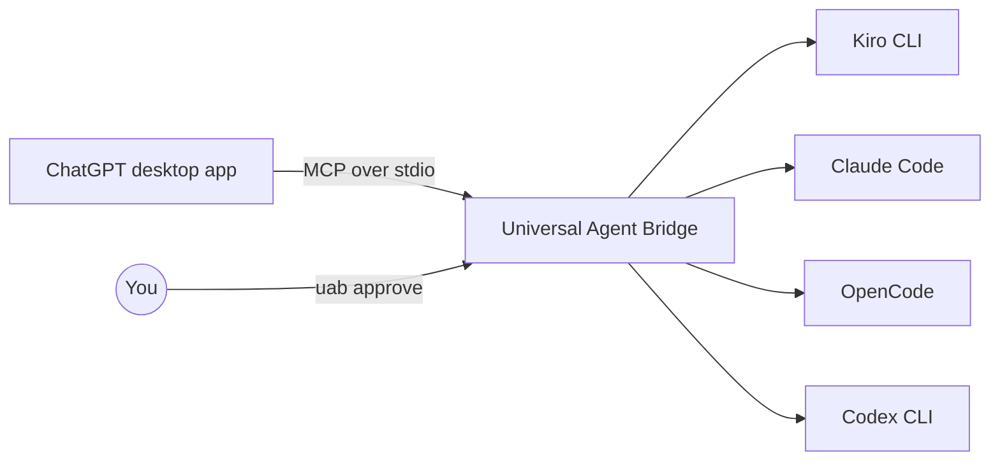

# Universal Agent Bridge (UAB)

> **Status: early development (Phase 1 of 12).** UAB cannot connect to ChatGPT or run any
> coding agent yet. This repository currently contains the research, the architecture and the
> project foundation. Do not install it expecting a working bridge.

UAB is a local MCP server for the **ChatGPT desktop app**. The goal is to let ChatGPT plan and
review work while locally installed coding CLIs (Kiro CLI, Claude Code, OpenCode, Codex CLI)
do the implementation, with a human approving every task before it reaches an agent.

## What exists today

- Research and gap analysis: [docs/research-and-gap-analysis.md](docs/research-and-gap-analysis.md)
- Architecture and phase plan: [docs/architecture.md](docs/architecture.md)
- TypeScript project setup with linting, formatting, tests and CI
- Core modules: configuration loading and validation, error codes, data-directory resolution,
  a stderr logger
- A `uab` command with `config`, `help` and `--version`

## Planned design (not implemented)



- Each ChatGPT conversation uses its own UAB session, identified by a session id and token,
  because the desktop app does not tell MCP servers which conversation is calling.
- ChatGPT proposes a task; you approve the exact prompt (bound to its hash) outside the chat;
  only then can the task be dispatched.
- Each coding CLI keeps its own login and its own permission rules.

See [docs/architecture.md](docs/architecture.md) for details and known limitations.

## Development

Requirements: Node.js 22.13 or later, npm.

```bash
git clone <repository-url>
cd universal-agent-bridge
npm install
npm run check      # typecheck, lint, format check, tests, build
node dist/cli.js --help
```

| Script                                                     | Purpose                      |
| ---------------------------------------------------------- | ---------------------------- |
| `npm run build`                                            | Compile `src/` to `dist/`    |
| `npm run typecheck`                                        | Type-check sources and tests |
| `npm run lint` / `lint:fix`                                | ESLint                       |
| `npm run format` / `format:check`                          | Prettier                     |
| `npm test`                                                 | All tests                    |
| `npm run test:unit` / `test:integration` / `test:security` | Test subsets                 |

## Licence

[MIT](LICENSE)
