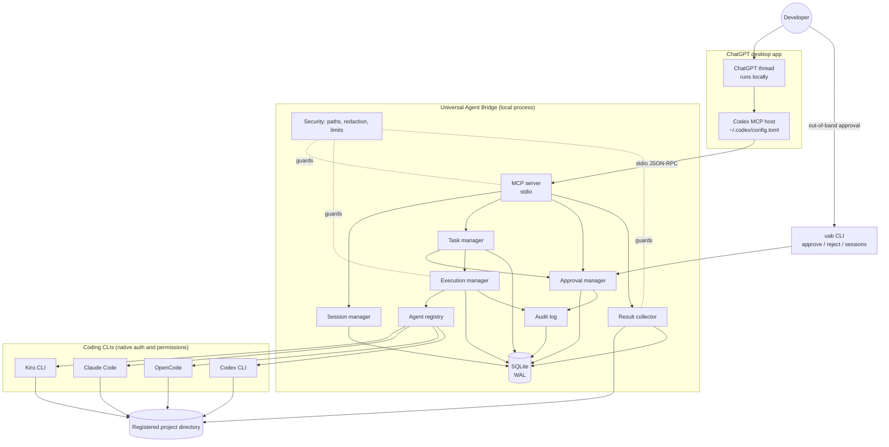
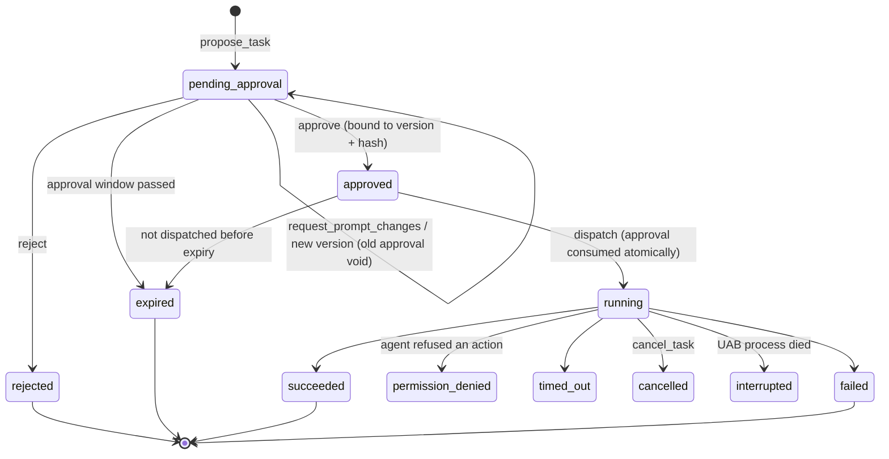

# Architecture

Status: Phases 1–3. Sections marked **(planned)** describe later phases. Implemented so far:
configuration, the SQLite database with migrations, project registration, the session
manager (section 3.3) and agent detection (section 5), exposed through the `uab` CLI. There is
no MCP server and no task execution yet.

Research behind these decisions: [research-and-gap-analysis.md](research-and-gap-analysis.md).

## 1. Overview



The ChatGPT host launches `uab mcp` as a stdio child process. UAB keeps all state in one
SQLite database in the UAB data directory. The `uab` command-line tool opens the same database,
so a human can approve or reject tasks from a terminal while ChatGPT is waiting.

## 2. Process model

- **One MCP server process per host connection.** The host may start more than one (for
  example, after restarting the app). All processes share the database, so state is consistent.
- **SQLite in WAL mode with `busy_timeout`** handles concurrent readers and short write
  transactions from several processes.
- **Agent runs are children of the MCP server process.** `dispatch_task` returns immediately;
  the run continues in the background and writes progress to the database.
- **Crash handling.** Each execution row stores the owning process id and a heartbeat. On
  startup, executions whose owner is gone are marked `interrupted`. They are never restarted
  automatically; the user must approve a new task.
- **Working-tree lock.** A row in `worktree_locks` keyed by canonical project path. Only one
  write-capable execution may hold it. A second dispatch on the same tree fails with
  `WORKTREE_BUSY`. Read-only task kinds (`review`, `diagnose`) do not take the lock, but their
  results are labelled if a writer was active at the same time.
- **A separate long-lived daemon** was considered so that runs survive host restarts. It is
  deferred because it adds a second local IPC surface that needs authentication. See risk R4.

## 3. Domain model

### 3.1 Entities

Implemented in Phase 2 (migration 1): `projects`, `sessions`, `session_agents`,
`session_events`, plus `schema_migrations`. The other tables are **(planned)**.

| Table                  | Key fields                                                                                                                                                                                                                  |
| ---------------------- | --------------------------------------------------------------------------------------------------------------------------------------------------------------------------------------------------------------------------- |
| `projects`             | `id`, `canonical_path` (unique, realpath), `display_name`, `created_at`                                                                                                                                                     |
| `sessions`             | `id` (`UAB-…`), `token_hash`, `project_id`, `agent_id`, `native_session_id` (per agent), `status` (`active` / `closed`), `title`, timestamps                                                                                |
| `session_agents`       | session id, agent id, native session id. Each agent keeps its own native session, so switching agents never hands one agent's conversation to another                                                                       |
| `tasks`                | `id`, `session_id`, `agent_id`, `kind` (`implement`, `fix`, `review`, `test`, `summarize`, `diagnose`), `title`, `status`, `current_version`                                                                                |
| `task_prompt_versions` | `task_id`, `version`, `prompt_text`, `prompt_sha256`, `created_at`, `source` (`chatgpt`)                                                                                                                                    |
| `approvals`            | `id`, `task_id`, `session_id`, `agent_id`, `project_path`, `prompt_sha256`, `prompt_version`, `decision` (`approved` / `rejected` / `changes_requested`), `channel` (`local` / `chat`), `expires_at`, `consumed_at`, `note` |
| `executions`           | `id`, `task_id`, `approval_id` (unique), `pid`, `owner_pid`, `heartbeat_at`, `status`, `exit_code`, `started_at`, `ended_at`                                                                                                |
| `execution_output`     | `execution_id`, `seq`, `stream`, `chunk` (redacted before insert), bounded total size                                                                                                                                       |
| `results`              | `execution_id`, final message, `agent_reported_status`, changed / created / deleted files, git status, diff stat, test summary, `verified` flags                                                                            |
| `worktree_locks`       | `canonical_path` (PK), `execution_id`, `owner_pid`, `acquired_at`                                                                                                                                                           |
| `audit_events`         | append-only: `ts`, `actor` (`mcp`, `cli`, `system`), `action`, `session_id`, `task_id`, details (redacted)                                                                                                                  |

No table stores provider credentials. Session tokens are stored only as SHA-256 hashes.

### 3.3 Projects and sessions (implemented, Phase 2)

**Database.** One file, `<data dir>/uab.db`, opened with `node:sqlite`, WAL journal,
`busy_timeout` 5 s, foreign keys on, `trusted_schema` off. Writes use `BEGIN IMMEDIATE`
transactions (nested calls use savepoints). Migrations are numbered, checksummed and applied
one per transaction, so several UAB processes can start at once. UAB refuses to open a database
written by a newer version (`DATABASE_TOO_NEW`) or whose applied migrations were edited
(`DATABASE_SCHEMA_MISMATCH`). Before migrating an existing database it writes
`uab.db.v<N>-<timestamp>.bak` with `VACUUM INTO`. On POSIX the directory is created `0700` and
the file `0600`.

**Project registration.** `uab project add <path>` accepts a directory only if it is an
absolute path, exists, is a directory, and after `realpath` (symlinks, junctions, 8.3 names and
letter case resolved) is not a filesystem root, not the home directory or a parent of it, and
does not overlap the UAB data directory. UNC and device paths are rejected on Windows. The
canonical path is stored, with a case-insensitive comparison key on Windows, so one directory
reached by different spellings or links is one project.

Over MCP, sessions can only use projects the user registered locally. The setting
`projects.allowMcpRegistration` (default `false`) lets ChatGPT register directories itself,
still under the same path policy.

**Project-relative paths** (`src/security/paths.ts`, used by later inspection tools) reject
absolute paths, drive letters, `..` segments, colons (NTFS streams), control characters,
Windows reserved names (`CON`, `NUL`, `COM1`…) and trailing dots or spaces on every platform.
`resolveInProject` then canonicalises the nearest existing ancestor and requires it to be inside
the project root, which blocks symlink escapes for existing files and for paths that do not
exist yet. Dangling links are rejected.

**Sessions.** `SessionManager` serves ChatGPT (and is what the Phase 7 MCP tools will call):

| Operation                          | Requires token | Notes                                                                       |
| ---------------------------------- | -------------- | --------------------------------------------------------------------------- |
| `create(project, agentId, title?)` | –              | Project and agent are explicit; returns the token once                      |
| `list()`                           | –              | Metadata only: id, title, status, agent, project name, timestamps           |
| `get`, `history`                   | yes            | Closed sessions remain readable                                             |
| `resume`                           | yes            | Active sessions only; records an event                                      |
| `switchAgent`                      | yes            | Each agent keeps its own `session_agents` row; nothing moves between agents |
| `close`                            | yes            | Idempotent                                                                  |

A wrong token, an unknown id, a malformed id and malformed credentials all return the same
`SESSION_NOT_FOUND` error. Tokens are `uab_st_` plus 32 random bytes (base64url); only SHA-256
hashes are stored and comparison is constant-time.

`SessionAdmin` serves the local operator through the CLI (`uab session list|show|history|close|
rotate-token`) and is not exposed over MCP. Session history (`session_events`) records
lifecycle events only, never prompts, tokens or agent output.

When another active session uses the same project directory, create and resume return a
warning. Write locking of the working tree is enforced in Phase 6.

### 3.2 Task state machine



Rules:

- No transition into `running` exists except from `approved`, and it happens in the same
  database transaction that consumes the approval.
- Editing the prompt creates a new version and voids any existing approval for the task.
- Terminal states are final. A correction is a **new task** that needs fresh approval, which
  rules out automatic correction loops.
- Expiry only ever moves a task to `expired`. Nothing moves a task to `approved` on a timer.

## 4. Approval design

See research §5.1 for the reasoning.

- Default channel `local`: approval only through `uab approve <task-id>` (or `uab reject`). The
  command prints the session, project, agent, task kind, prompt version, full prompt and prompt
  hash, then asks for confirmation.
- Opt-in channel `chat`: MCP `approve_task` must include `promptSha256`. UAB rejects it if the
  hash does not match the current version. Documentation tells users to set
  `tools.approve_task.approval_mode = "approve"` in the host config.
- Dispatch checks: approval exists, decision is `approved`, not consumed, not expired,
  `session_id`, `agent_id`, `project_path`, `prompt_version` and `prompt_sha256` all equal the
  current values, and the caller presented the session token for that session.
- **Layer 2** (agent-native permissions) is untouched. UAB passes only the permission flags the
  user configured for that agent and project, and never the dangerous flags listed in research
  §2.1. Approval to dispatch a prompt does not grant the operations the prompt asks for.

Default permission profile (applied by adapters where the CLI supports the setting):

| Operation                                                    | Default                                                                                                     |
| ------------------------------------------------------------ | ----------------------------------------------------------------------------------------------------------- |
| Read project files                                           | Allowed                                                                                                     |
| Edit project source files                                    | Agent-native rules (headless CLIs deny unless the user allowlisted edits)                                   |
| Run tests                                                    | Agent-native rules                                                                                          |
| Install dependencies, delete files, migrations, edit `.env*` | Ask → in headless mode this means deny                                                                      |
| Access outside the project directory                         | Deny                                                                                                        |
| `git commit`, `git push`                                     | Deny for the agent. Git write operations are separate task kinds that need their own approval **(planned)** |
| Production deployment                                        | Deny                                                                                                        |

## 5. Agent adapters (implemented in Phase 3: detection)

Code: `src/agents/`. User-facing details per agent: [supported-agents.md](supported-agents.md).

An agent is described by an `AgentDefinition` (`src/agents/types.ts`). Definitions are data
plus pure parsers. They never spawn processes themselves: the registry and, from Phase 6, the
execution manager do that, so timeouts, tree kill, output caps, environment filtering and
argument checks exist once.

```ts
interface AgentDefinition {
  id: string; // stable public id: 'kiro' | 'claude' | 'opencode' | 'codex' | …
  displayName: string;
  executableNames: string[]; // looked up on PATH
  versionProbe: { args: string[]; parse(out): string | undefined }; // getVersion
  authProbe: { args: string[]; parse(out): AuthResult }; // checkAuthentication
  envPassthrough: string[]; // extra env names the CLI needs for its own login
  forbiddenArgs: ForbiddenArg[]; // flags that weaken native permissions; never passed
  capabilities: { resume; callerChosenSessionId; structuredEvents };
  instructions: { install: string[]; authenticate: string[]; docsUrl: string };
  notes?: string[];
  execution?: AgentExecution; // Phase 4+: buildInvocation, parseEvent, summarize
}
```

Mapping from the conceptual interface in the requirements:

| Requirement                                                     | Where it lives                                                      |
| --------------------------------------------------------------- | ------------------------------------------------------------------- |
| `detectInstallation`, `getVersion`                              | `executableNames` + `versionProbe`, run by `AgentRegistry.status()` |
| `checkAuthentication`                                           | `authProbe`, run by `AgentRegistry.status()`                        |
| `startSession`, `resumeSession`, `executeTask`, `collectOutput` | `execution` (Phase 4 onwards)                                       |
| `getExecutionStatus`, `terminateExecution`                      | execution manager (Phase 6), shared by all agents                   |
| `cleanupSession`                                                | session manager                                                     |

**Registry** (`src/agents/registry.ts`). Validates definitions (id format, program names,
environment names, probes must not use forbidden flags), applies the config section
`agents.<id>.enabled|executable`, and reports per agent: `ready`, `not_installed`,
`not_authenticated`, `auth_unknown`, `disabled` or `error`, with version, program path,
auth method label, the names of set passthrough variables and plain-language problems.
Sessions accept only agent ids the registry reports as available.

**Probe rules.** Probes are constant, read-only status commands (`--version`, `whoami`,
`auth status`, `providers list`, `login status`). They run in the OS temp directory, never in a
project, with a filtered environment, no stdin, a 15 s timeout and a 64 KB output cap. Parsers
return only allowlisted fields: a state, a short label matching `[A-Za-z][A-Za-z0-9_.-]*`, and
UAB-written text. Raw CLI output, emails, account ids, URLs and keys never leave the parser.
Unreadable output is `unknown`, never `authenticated`.

**Forbidden arguments** (`src/agents/args.ts`). `assertSafeArgs` refuses any argument list
containing a flag from the agent's deny list, in `--flag`, `--flag=value` and `--flag value`
forms, with optional value lists and patterns. Text after `--` is treated as prompt content.
Phase 4+ invocations must pass this check before spawning.

**Process runner** (`src/execution/process.ts`). `spawn` with `shell: false`, absolute program
path, argument array, explicit environment, stdin for input, per-stream byte cap, timeout and
abort that kill the whole tree (`taskkill /T /F` on Windows, process group on POSIX). It refuses
relative paths, NUL bytes and, on Windows, `.cmd`/`.bat`/`.ps1`/`.js` files.

**Environment** (`src/execution/env.ts`). Children get only an allowlist (PATH, home and
app-data directories, temp, locale, proxy settings, Windows system variables) plus the
definition's `envPassthrough` names, and `NO_COLOR=1`, `CI=1`, `TERM=dumb`. Matching is
case-insensitive on Windows.

### Windows program resolution

`src/agents/resolve.ts` searches absolute PATH entries only (relative entries are ignored so a
project folder cannot shadow a CLI) with the `.exe`, `.com`, `.cmd` and `.bat` extensions from
PATHEXT, native programs first. npm installs CLIs as `.cmd` wrappers, which Node cannot start
without a shell. UAB reads the wrapper (at most 64 KB) and recognises the two cmd-shim forms:
a direct native program, or `"%_prog%" "<script>"` (run as `node <script>`). The target must
exist inside the wrapper's own directory tree. Anything else is reported as
`unsupported_wrapper` and the user can set `agents.<id>.executable`. UAB never runs a wrapper
through `cmd.exe`.

Adding an agent means adding a definition to `src/agents/adapters/` and to `BUILTIN_AGENTS`.
No other core code changes.

## 6. MCP tool catalogue (planned, Phase 7)

All tools validate input with Zod and return `structuredContent` plus a short text summary.
Errors use the codes in `src/core/errors.ts`. **There is no shell, command or file-write tool.**

| Group              | Tools                                                                                                                      | Read-only hint          |
| ------------------ | -------------------------------------------------------------------------------------------------------------------------- | ----------------------- |
| Sessions           | `create_session`, `list_sessions`, `get_session`, `resume_session`, `close_session`, `switch_agent`, `get_session_history` | only `list_*` / `get_*` |
| Agents             | `list_agents`, `get_agent_status`, `check_agent_authentication`, `get_agent_version`                                       | yes                     |
| Project inspection | `get_project_structure`, `get_git_status`, `get_changed_files`, `get_git_diff`                                             | yes                     |
| Tasks              | `propose_task`, `revise_task_prompt`, `get_task`, `list_tasks`, `get_task_status`, `dispatch_task`, `cancel_task`          | only `get_*` / `list_*` |
| Approvals          | `get_pending_approvals`, `get_approval_details`, `approve_task`, `reject_task`, `request_prompt_changes`                   | only `get_*`            |
| Results            | `get_task_result`, `get_execution_logs`, `get_test_results`, `get_execution_summary`                                       | yes                     |

Two tools are additions to the suggested list: `revise_task_prompt` (creates a new prompt
version) and `dispatch_task` (starts an approved task). Dispatch is separate from approval so
that out-of-band approval works: the human approves in the terminal, then ChatGPT dispatches.

Large outputs are paged with `cursor` and `limit` and filtered by stream or pattern. Every
response passes through secret redaction and a size cap.

## 7. Security model

Untrusted inputs: everything ChatGPT sends, project file contents, agent output and terminal
output. Trusted: the local user at the terminal and UAB's own configuration file.

| Control                        | Mechanism                                                                                                                                                                           | Phase   |
| ------------------------------ | ----------------------------------------------------------------------------------------------------------------------------------------------------------------------------------- | ------- |
| Project confinement            | Paths canonicalised with `realpath`, compared case-insensitively on Windows, and required to be inside the registered root after symlink resolution                                 | 2, 11   |
| No arbitrary filesystem access | Inspection tools accept only project-relative paths; they reject absolute paths, `..` segments, NUL bytes, device names and symlinks that leave the root                            | 2, 11   |
| Safe process creation          | `spawn` with `shell: false`, absolute executable path, argument arrays, prompt via stdin, minimal environment allowlist                                                             | 6       |
| Dangerous flags                | Each adapter has a deny-list test for the flags in research §2.1                                                                                                                    | 4, 8–10 |
| Timeouts and kill              | Per-execution timeout; process-tree kill (`taskkill /T` on Windows, process group on POSIX)                                                                                         | 6       |
| Output limits                  | Byte cap per execution and per MCP response; paging                                                                                                                                 | 6       |
| Secret redaction               | Pattern-based redaction (API key formats, bearer tokens, private keys, `.env` values) before storage and before every response; `.env*` contents are never returned                 | 6, 11   |
| Approval integrity             | Hash binding, versioning, single use, expiry, out-of-band default                                                                                                                   | 5       |
| Session isolation              | Token per session, constant error for wrong id or token, per-session queries only                                                                                                   | 2       |
| Prompt injection               | Agent output and file contents are returned as data, marked as untrusted in tool descriptions and server instructions; nothing in them can trigger an action without a new approval | 6, 7    |
| Audit                          | Append-only audit events for every proposal, decision, dispatch, cancel and failure                                                                                                 | 5       |
| Database                       | Stored in the user's data directory; no credentials stored; parameterised queries only                                                                                              | 2       |
| Logging                        | Logs go to stderr only (stdout carries MCP JSON-RPC), and pass through redaction                                                                                                    | 1       |

## 8. Source layout

```
src/
  cli.ts                 # `uab` entry point
  core/                  # config, errors, logger, app paths (Phase 1)
  database/              # connection, migrations (Phase 2, implemented)
  projects/              # registration (Phase 2, implemented)
  sessions/              # session manager and operator admin (Phase 2, implemented)
  agents/                # definitions, registry, program resolution (Phase 3, implemented);
                         # execution adapters (Phases 4, 8–10)
  execution/             # process runner and child environment (Phase 3); manager (Phase 6)
  approvals/             # approval manager (Phase 5)
  tasks/                 # task manager (Phase 5)
  results/               # git + test result collection (Phase 6)
  security/              # path guard, redaction, limits (Phases 2, 6, 11)
  audit/                 # audit writer (Phase 5)
  mcp/                   # server, tools, schemas (Phase 7)
tests/
  unit/  integration/  security/  fixtures/
```

## 9. Phase plan

The requested order is kept. Two dependencies were confirmed during research and are already
satisfied by that order: the approval system (5) and execution manager (6) come before the MCP
surface (7), so no MCP path to an agent exists before approval is enforced.

| Phase | Scope                                                                                                    |
| ----- | -------------------------------------------------------------------------------------------------------- |
| 1     | Research, architecture, foundation (this phase)                                                          |
| 2     | SQLite connection and migrations, project registration with path validation, session manager with tokens |
| 3     | Adapter interface, registry, detection and auth probing framework, mock CLI fixtures                     |
| 4     | Kiro adapter (includes manual check of headless authentication)                                          |
| 5     | Tasks, prompt versions, approvals, `uab approve` / `uab reject`, audit                                   |
| 6     | Execution manager, locks, timeouts, output capture, redaction, result collection                         |
| 7     | MCP server and tools, desktop config generation (`uab mcp-config`)                                       |
| 8–10  | Claude Code, OpenCode, Codex adapters                                                                    |
| 11    | Security hardening and full test matrix                                                                  |
| 12    | README, docs, open-source files, PR                                                                      |

## 10. Risks

| #   | Risk                                                                                               | Mitigation                                                                                                                       |
| --- | -------------------------------------------------------------------------------------------------- | -------------------------------------------------------------------------------------------------------------------------------- |
| R1  | ChatGPT Chat mode on some Windows/Plus setups does not expose local MCP tools (openai/codex#38162) | Document the local-thread workaround; manual verification step in Phase 7; state the limitation in the README                    |
| R2  | No conversation id from the host (openai/codex#54683)                                              | Explicit session id + token binding                                                                                              |
| R3  | Model calls `approve_task` itself                                                                  | `local` approval channel by default; `chat` channel is opt-in, hash-bound and documented as weaker                               |
| R4  | Host restarts the MCP process and kills a running agent                                            | Mark `interrupted`, never re-run; consider a daemon later                                                                        |
| R5  | Kiro headless may need `KIRO_API_KEY` (paid plans)                                                 | Detect and report clearly; user supplies it via their own environment; never stored by UAB                                       |
| R6  | Headless CLIs deny edits unless allowlisted, so tasks "fail"                                       | Report `permission_denied` distinctly; document per-agent allowlist setup; later Layer-2 permission relay                        |
| R7  | CLI flags and output formats change between versions                                               | Adapters record the tested version range; detection warns outside it; parsers tolerate unknown events; fixture tests per version |
| R8  | `node:sqlite` stability across Node 22/24/26                                                       | CI matrix; `better-sqlite3` fallback behind the database module                                                                  |
| R9  | Windows `.cmd` shims cannot be spawned without a shell                                             | Resolve real executables during detection                                                                                        |
| R10 | Codex CLI not installed on the development machine                                                 | Codex adapter built from docs plus fixtures; marked as needing manual verification                                               |
