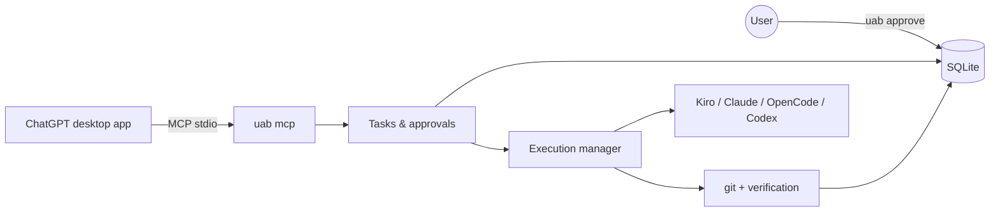

# Universal Agent Bridge 0.1.0

## Overview

UAB is a local MCP server that lets the **ChatGPT desktop app** hand tasks to coding CLIs
installed on the user's computer (Kiro CLI, Claude Code, OpenCode, Codex CLI), with **human
approval of every task** and the agents' own permission systems left on. Results (final
message, changed files, git diff, independent test run) return to the same ChatGPT
conversation.

This PR contains all twelve phases: research, database and sessions, agent registry, Kiro
integration, approvals, execution and results, MCP server, Claude Code, OpenCode, Codex,
hardening, and documentation.

## Architecture



- ChatGPT desktop starts `uab mcp` (configured in `~/.codex/config.toml`; `uab mcp-config`
  generates the block).
- Sessions use an explicit id and token, because the desktop app gives MCP servers no
  conversation id (openai/codex#54683).
- Approval happens out of band (`uab approve`) by default, bound to the SHA-256 of the exact
  prompt.
- Agents run without a shell, prompt on stdin, in the registered project directory.

Details: `docs/architecture.md`, `docs/research-and-gap-analysis.md`, `docs/security.md`.

## Features

- 31 MCP tools: sessions, agents, read-only project inspection, tasks, approvals, results. No
  shell or file-write tool.
- Approval queue: versions, hash binding, single use, 60-minute expiry, reject, request changes,
  append-only audit log. Nothing is approved automatically.
- Execution: background runs, timeout, cancel with process-tree kill, one writer per working
  tree, crash recovery without re-running, native session resume per UAB session.
- Results: agent-reported success kept separate from UAB's own verification command, changed
  files (with pre-existing changes marked), commits created, permission denials, redacted logs
  with paging and filtering.
- Detection of each CLI's installation, version and native login; UAB never handles
  credentials.

## Agent integrations

| Agent       | Status                                                                                                                                                                                                                                                                                                                       |
| ----------- | ---------------------------------------------------------------------------------------------------------------------------------------------------------------------------------------------------------------------------------------------------------------------------------------------------------------------------- |
| Kiro CLI    | **Verified end to end** with 2.27.1 on Windows 11. `uab agents setup kiro` installs `uab-read` and `uab-write` profiles (`allowedPaths: ["./**"]`, no pre-approved tools). Verified: a file was created inside the project, a write to `../outside.txt` was refused, the session was resumed, and a normal login was enough. |
| Claude Code | Implemented (`-p --output-format stream-json`, `dontAsk` for read-only tasks, `acceptEdits` for write tasks). Output format and the 401 event were checked against 2.1.220. **Not verified with a successful run**: the test machine's API key was rejected, and UAB reports this as an authentication error within seconds. |
| OpenCode    | Implemented (`run --format json --dir`, `plan` agent for read-only tasks). Error events checked against 1.19.3. **Not verified with a successful run** (provider account without credit).                                                                                                                                    |
| Codex CLI   | Implemented from the documentation (`exec --json --sandbox read-only/workspace-write`). **Not verified**: Codex was not installed.                                                                                                                                                                                           |

## Session isolation

- Every session-scoped tool requires the session id **and** a 256-bit token (stored as
  SHA-256, compared in constant time).
- Wrong id and wrong token return the same error.
- Tasks, results and logs are filtered by session; another session gets `TASK_NOT_FOUND`.
- Each agent keeps its own native conversation per session.
- `rotate-token` moves a session to a new conversation and revokes the old one.

## Approval workflow

`propose_task` → (`dispatch_task` fails with `APPROVAL_REQUIRED`) → user runs
`uab approve <id>` and sees the complete prompt and its hash → `dispatch_task` consumes the
approval atomically → results. Revising the prompt voids the approval. A correction is always a
new task.

## Security controls

Summary (full list in `docs/security.md`):

- No shell; Windows npm `.cmd` wrappers are unwrapped, never executed through `cmd.exe`.
- Per-agent deny lists of permission-bypass flags, checked before every spawn.
- Path guard with `realpath`, symlink and junction checks; dangerous project roots refused.
- Environment allowlist for child processes.
- Secret redaction and sensitive-file filtering; output caps.
- Results labelled as untrusted content, with server instructions against prompt injection.
- Append-only audit log enforced by database triggers.

## Testing performed

- `npm run check` (typecheck, ESLint, Prettier, build, tests): **439 passed, 2 skipped**
  (POSIX-only file-symlink tests), in 28 files. Run twice; stable.
- The tests use a mock CLI that is installed like an npm package, so no real CLI or account is
  needed. Coverage includes:
  - approval required, rejection and replay
  - expiry, revision invalidation and hash tampering
  - cross-session access
  - command injection through prompts and test commands
  - path traversal, symlink and junction escapes
  - secret redaction
  - timeouts and process-tree kill, cancellation
  - working-tree lock and crash recovery
  - every MCP tool through an in-memory MCP client
  - the built `uab mcp` over real stdio
- Manual end to end with real Kiro CLI 2.27.1 through the MCP stdio server:
  1. create session
  2. propose
  3. dispatch refused before approval
  4. `uab approve`
  5. dispatch: the file was created, the outside write refused, verification passed
  6. a second task resumed the Kiro conversation
- Manual runs with real Claude Code and OpenCode: both failed fast with clear provider errors
  (account problems on the test machine, not UAB).
- `npm audit`: 0 vulnerabilities. Secret and personal-path scan: no real values (only fake test
  fixtures used to prove redaction).

## Known limitations and items needing manual verification

- Claude Code, OpenCode and Codex CLI need a successful real run by someone with working
  accounts.
- Only Windows 11 was used for manual testing; macOS and Linux run in CI only.
- ChatGPT desktop issue openai/codex#38162: on some Windows/Plus setups, local MCP tools are not
  offered in plain Chat threads. The documented workaround is to use a local thread. **The
  ChatGPT desktop app itself was not exercised in this environment**; the MCP server was tested
  with the official SDK client over stdio.
- Agent permission prompts are not forwarded to the user during a run. Agents need their rules
  set up front: Kiro profiles, `agents.claude.allowTools`, OpenCode's `permission` settings.
- OpenCode's default agent may edit files and run commands without asking unless the user
  configures `permission`.
- If the ChatGPT app restarts UAB during a run, the run is stopped and marked `interrupted`.

## Installation

See README → Installation and Connect ChatGPT Desktop:

```bash
npm install && npm run build && npm link
uab mcp-config      # paste into ~/.codex/config.toml, restart the ChatGPT app
uab agents setup kiro
uab project add /absolute/path/to/project
```

## Documentation

- `README.md`
- `docs/architecture.md`, `docs/security.md`, `docs/supported-agents.md`
- `docs/troubleshooting.md`, `docs/development.md`, `docs/research-and-gap-analysis.md`
- `CONTRIBUTING.md`, `SECURITY.md`, `CHANGELOG.md`
